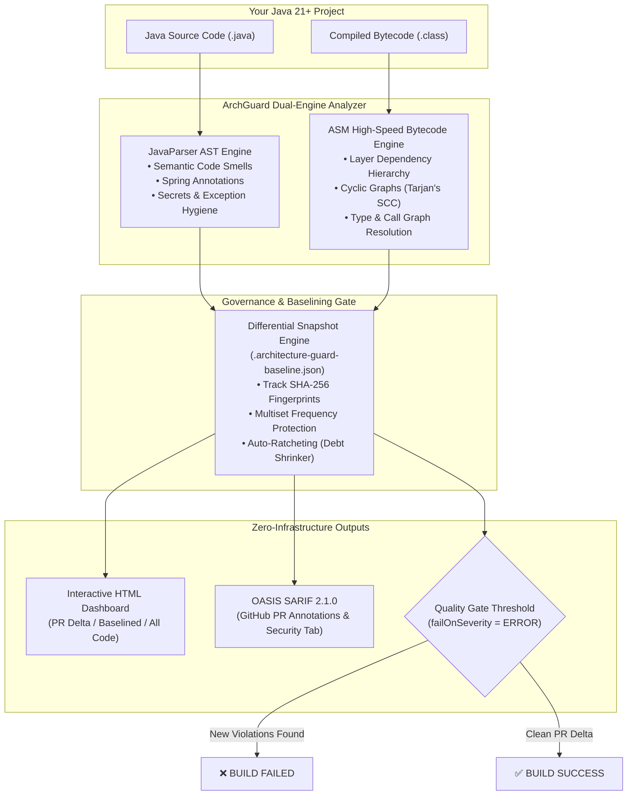

# 🛡️ ArchGuard — Features & Competitive Landscape

<p align="center">
  
  
  
  
  
  
</p>

> **The Next-Generation Architecture Governance, Spring Boot Intelligence & Zero-Infrastructure Code Quality Gate.**

---

## 📑 Table of Contents
1. [The "Why ArchGuard?" Problem Statement](#1-the-why-archguard-problem-statement)
2. [How It Works: Hybrid Dual-Engine Architecture](#2-how-it-works-hybrid-dual-engine-architecture)
3. [Top 5 "Killer Capabilities"](#3-top-5-killer-capabilities)
4. [Memory & Resource Safety: What ArchGuard Detects (and What It Doesn't)](#4-memory--resource-safety-what-archguard-detects-and-what-it-doesnt)
5. [Head-to-Head Comparison Matrix](#5-head-to-head-comparison-matrix)
6. [In-Depth Tool Battles](#6-in-depth-tool-battles)
   - [ArchGuard vs SonarQube / SonarCloud](#1-archguard-vs-sonarqube--sonarcloud)
   - [ArchGuard vs ArchUnit](#2-archguard-vs-archunit)
   - [ArchGuard vs SpotBugs / FindBugs](#3-archguard-vs-spotbugs--findbugs)
   - [ArchGuard vs Checkstyle & PMD](#4-archguard-vs-checkstyle--pmd)
7. [Complete 29-Rule Quality Catalog (AG001 – AG029)](#7-complete-29-rule-quality-catalog-ag001--ag029)
8. [Enterprise Developer Experience & Reporting](#8-enterprise-developer-experience--reporting)
9. [Get Started in Under 60 Seconds](#9-get-started-in-under-60-seconds)
10. [Next-Gen Strategic Roadmap](#10-next-gen-strategic-roadmap)

---

## 1. The "Why ArchGuard?" Problem Statement

Every software team runs linters and quality gates. Yet, production outages, memory leaks, and architectural erosion still happen every single day in Spring Boot services:

```
❌ A @Transactional method calls another @Transactional method in the same class (proxy bypass)
   👉 Result: Transaction never commits; silent data corruption in production!

❌ A singleton @Service contains a non-final List or SimpleDateFormat
   👉 Result: Multi-threaded race conditions; User A sees User B's private account data!

❌ A @RestController returns a JPA @Entity directly instead of a DTO/Record
   👉 Result: Mass-assignment vulnerability, Cartesian N+1 DB explosion, LazyInitializationException!

❌ A team turns on a quality gate on a 5-year-old enterprise application
   👉 Result: 3,400 legacy violations trigger build failures; developers revolt and disable the tool!
```

### Why Existing Tools Leave You Exposed:
- **Linters (Checkstyle, PMD):** Only inspect text/syntax. They don't understand bytecode, type hierarchies, or Spring proxies.
- **Bug Finders (SpotBugs):** Only inspect isolated bytecode. They have zero awareness of layered architecture or Spring bean scopes.
- **Enterprise Suites (SonarQube):** Require heavy server installations, databases, cloud licensing, network latency, and miss Spring-specific runtime traps.
- **Testing Libraries (ArchUnit):** Require writing and maintaining hundreds of lines of imperative JUnit test code with zero built-in differential debt ratcheting.

### 💡 The ArchGuard Solution:
**ArchGuard** is built from the ground up specifically for **Modern Java 21+ and Spring Boot 3+**. It combines **ASM Bytecode Analysis** with **JavaParser AST Inspection** into a single, lightning-fast Maven plugin with zero server infrastructure, automated ratcheting baselines, and native GitHub SARIF integration.

---

## 2. How It Works: Hybrid Dual-Engine Architecture

ArchGuard executes directly in the Maven `verify` lifecycle in milliseconds without sending code over the network:



---

## 3. Top 5 "Killer Capabilities"

### 🔥 1. Spring AOP Proxy Self-Invocation Hunter (`AG021`)
In Spring, `@Transactional`, `@Async`, `@Cacheable`, `@Retryable`, and `@Scheduled` work via dynamic AOP proxies. When a method calls another annotated method in the **same class** (`this.method()`), Spring proxies are bypassed silently.

```java
// ❌ SILENT PRODUCTION DISASTER: The @Transactional proxy is bypassed!
@Service
public class OrderService {
    public void processAll(List<Order> orders) {
        for (Order order : orders) {
            saveWithAudit(order); // Calls directly via 'this', bypassing Spring proxy!
        }
    }

    @Transactional // NEVER OPENS A TRANSACTION WHEN CALLED FROM processAll()!
    public void saveWithAudit(Order order) {
        orderRepo.save(order);
        auditRepo.record(order);
    }
}
```
> **ArchGuard catches this instantly during `mvn compile` and suggests extracting the transactional boundary into an injected bean or programmatic `TransactionTemplate`.**

---

### 🔥 2. Singleton Bean Concurrency & Mutable State Guard (`AG022`)
Spring Beans are singletons shared across concurrent HTTP request worker threads. Defining mutable instance state or non-thread-safe utilities in `@Service` or `@Component` leads to catastrophic data leaks.

```java
// ❌ RACE CONDITION: Shared across all concurrent HTTP requests!
@Service
public class PaymentProcessingService {
    private List<Payment> recentPayments = new ArrayList<>(); // Corrupted under concurrency!
    private SimpleDateFormat sdf = new SimpleDateFormat("yyyy-MM-dd"); // Throws NumberFormatException / cross-talk!
    private int transactionCounter = 0; // Lost updates!
}
```
> **ArchGuard flags non-final mutable fields in Spring singletons and mandates thread-safe alternatives (`java.time.DateTimeFormatter`, scoped state, or concurrent collections).**

---

### 🔥 3. Zero-Fatigue Differential Baselining with Auto-Ratcheting
Adopting quality gates in large enterprise codebases usually fails because developers are overwhelmed by thousands of legacy warnings they didn't write.

```bash
# Day 1: Freeze all legacy technical debt in 1 command
mvn architecture-guard:baseline
```

1. **Only New Debt Fails the Build:** PRs only fail if the developer adds **new** violations.
2. **Multiset Protection:** If a legacy class has 1 warning, adding a 2nd warning in the same file is recognized as **new** debt and blocked!
3. **Automatic Ratchet (`-Darchguard.ratchet=true`):** As developers refactor and clean up old code, the baseline snapshot shrinks automatically. **Technical debt can only decrease, never increase.**

---

### 🔥 4. REST API & Domain Boundary Firewall (`AG001`, `AG012`, `AG015`, `AG016`)
Protects your application's external API boundary and internal domain model:

```java
// ❌ ARCHITECTURAL BREACH & SECURITY VULNERABILITY
@RestController
public class UserController {
    @Autowired
    private UserRepository userRepository; // AG001: Controller directly touches DB!

    @GetMapping("/users")
    public List<UserEntity> getAllUsers() { // AG012: JPA Entity exposed! AG016: Unpaginated List!
        return userRepository.findAll();
    }

    @PostMapping("/users")
    public UserEntity createUser(@RequestBody UserEntity user) { // AG015: Missing @Valid!
        return userRepository.save(user);
    }
}
```
> **ArchGuard enforces clean architecture: Controllers talk only to Services, expose Java 21 Records/DTOs, enforce `@Valid` request bodies, and return paginated collections (`Page<T>`).**

---

### 🔥 5. Zero-Infrastructure Native GitHub SARIF 2.1.0 & HTML Dashboard
No server to host, no license keys, no Docker containers:
- **GitHub PR Inline Annotations:** Generates standard OASIS SARIF 2.1.0 uploaded via `github/codeql-action/upload-sarif@v3`. Annotations appear directly on the changed lines of your GitHub Pull Request.
- **Security Tab Integration:** All architecture and security violations populate the native **GitHub Security → Code Scanning** dashboard for free on public repositories.
- **Offline Interactive HTML Dashboard:** Self-contained report with zero CDN dependencies, live filtering by scope (**PR Delta**, **Baselined Debt**, **All Code**), dark/light theme, and copy-paste remediation code.

---

## 4. Memory & Resource Safety: What ArchGuard Detects (and What It Doesn't)

To maintain absolute technical integrity, here is an exact, transparent breakdown of how ArchGuard addresses memory and resource hazards:

### ✅ What ArchGuard Handles (Static Code Root-Cause Analysis)
ArchGuard detects the **static code patterns and architectural smells** that directly trigger JVM memory leaks, native resource exhaustion, and `OutOfMemoryError` (OOM) crashes in production:

1. **Unbounded Static Memory Accumulation (`AG010`):**
   - Non-final static fields or mutable collections (`static List<T>`, `static Map<K,V>`).
   - *Why it matters:* In the JVM, static variables are attached directly to classloader GC roots and **never garbage-collected**, creating permanent memory leaks across HTTP requests.
2. **Spring Singleton Bean Memory Retention (`AG022`):**
   - Mutable instance collections and non-thread-safe state inside `@Service`, `@Component`, or `@RestController` beans.
   - *Why it matters:* Because Spring singleton beans live for the entire application lifecycle, accumulating data in instance fields causes unbounded heap growth.
3. **OS File Descriptor & Connection Pool Leaks (`AG024`):**
   - Instantiating `AutoCloseable` streams (`FileInputStream`, `FileOutputStream`, `BufferedReader`) or JDBC resources (`Connection`, `Statement`, `ResultSet`) outside a **try-with-resources** block.
   - *Why it matters:* Exceptions before an explicit `.close()` leak OS file handles, sockets, and pool connections, leading to crash states.
4. **JVM OutOfMemoryError via Unbounded Database Queries (`AG016`):**
   - Returning raw `List<T>` from REST endpoints instead of `Page<T>` or slice pagination.
   - *Why it matters:* Fetching 100,000+ records in a single HTTP request forces the JVM to materialize massive object graphs in heap, causing sudden `java.lang.OutOfMemoryError: Java heap space`.
5. **Garbage Collection (GC) Thrashing from String Concatenation (`AG025`):**
   - Using `+` or `+=` inside loops (`for`, `while`).
   - *Why it matters:* Repeated concatenation creates $N$ intermediate immutable `String` instances on every iteration, leading to $O(n^2)$ heap allocation and frequent Stop-The-World GC pauses.
6. **Cartesian Product Heap Bloat (`AG014`):**
   - Using JPA `FetchType.EAGER` relationships.
   - *Why it matters:* Eager joins trigger Cartesian product query returns from the database, loading thousands of redundant entities into the JVM heap.
7. **ThreadLocal Memory Leaks & Worker Contamination (`AG028`):**
   - Calling `ThreadLocal.set()` without guaranteed `.remove()` in an enclosing `finally` block.
   - *Why it matters:* Web containers (Tomcat, Jetty, Undertow) recycle worker threads from fixed thread pools. Uncleaned `ThreadLocal` entries remain pinned to `Thread` objects indefinitely, leading to classloader memory leaks and cross-request user/tenant context leaks.
8. **Unbounded Thread Allocation & Native Thread Starvation (`AG029`):**
   - Using `@Async` without an explicit `ThreadPoolTaskExecutor` qualifier.
   - *Why it matters:* Defaulting to `SimpleAsyncTaskExecutor` spawns an unbounded new OS thread for every single asynchronous task call, triggering `java.lang.OutOfMemoryError: unable to create new native thread` under load.

### ❌ What ArchGuard Does NOT Handle (Transparent Boundaries)
ArchGuard is a **static analysis code gate**, not a runtime JVM profiler:
- **No Dynamic Heap Dump Analysis:** ArchGuard does not inspect live JVM heap dumps (`.hprof`), JVM flags (`-Xmx`, `-Xms`), or live object retention trees. (Use tools like *Eclipse MAT* or *YourKit* for post-mortem heap dump profiling).
- **No Live Memory Allocation Profiling:** ArchGuard cannot measure the dynamic runtime byte size of objects in flight. (Use *JProfiler* or *VisualVM* for runtime telemetry).
- **No Native Memory Profiling:** ArchGuard does not track off-heap JNI/C++ allocations.

---

## 5. Head-to-Head Comparison Matrix

| Capability / Feature | 🛡️ **ArchGuard** | 🏢 **SonarQube** | 📐 **ArchUnit** | 🐛 **SpotBugs** | 🎨 **Checkstyle / PMD** |
| :--- | :---: | :---: | :---: | :---: | :---: |
| **Server / Cloud Infrastructure** | **None (100% Embedded)** | Heavy Server + DB | None (JUnit tests) | None (Plugin) | None (Plugin) |
| **Execution Speed** | **< 3 seconds** | Minutes (Remote queue) | Test suite overhead | Fast | Fast |
| **Cost & Licensing** | **100% Free & Open Source** | Expensive Enterprise Tier | Free & Open Source | Free & Open Source | Free & Open Source |
| **Spring Proxy Self-Invocation (`AG021`)** | ✅ **Built-in Native** | ❌ None | ⚠️ Custom test code | ❌ None | ❌ None |
| **Spring Singleton Race Conditions (`AG022`)**| ✅ **Built-in Native** | ⚠️ Static only | ⚠️ Custom test code | ⚠️ Static only | ❌ None |
| **Direct JPA Entity REST Leakage (`AG012`)** | ✅ **Built-in Native** | ❌ None | ⚠️ Custom test code | ❌ None | ❌ None |
| **Architectural Layer Enforcement** | ✅ **Declarative YAML** | ⚠️ Enterprise only | ✅ Java DSL unit tests| ❌ None | ⚠️ Basic imports |
| **Cyclic Dependency Detection (Cycles)** | ✅ **Package & Class** | ✅ Project level | ✅ Package level | ❌ None | ❌ None |
| **Missing `@Transactional` Boundary (`AG009`)**| ✅ **Built-in Native** | ❌ None | ⚠️ Custom test code | ❌ None | ❌ None |
| **JPA Eager Fetch / N+1 Risk (`AG014`)** | ✅ **Built-in Native** | ❌ None | ⚠️ Custom test code | ❌ None | ❌ None |
| **Differential Baselining (PR Delta)** | ✅ **Multiset Snapshot** | ✅ New Code Period | ❌ None | ⚠️ XML Filter | ⚠️ Suppressions |
| **Automatic Debt Ratcheting** | ✅ **Built-in Mode** | ❌ Manual tuning | ❌ None | ❌ None | ❌ None |
| **Interactive Offline HTML Dashboard** | ✅ **Included (Zero CDN)**| ❌ Web server only | ❌ None | ⚠️ Basic static | ⚠️ Basic static |
| **GitHub Security / SARIF 2.1.0** | ✅ **Native Output** | ⚠️ Plugin / Action | ❌ None | ⚠️ Via plugin | ⚠️ Via plugin |
| **Setup Time** | **60 Seconds (`init`)** | Hours / Days | Hours writing tests | 10 Minutes | 10 Minutes |

---

## 6. In-Depth Tool Battles

### 1. ArchGuard vs SonarQube / SonarCloud

| Comparison Vector | 🛡️ ArchGuard | 🏢 SonarQube |
| :--- | :--- | :--- |
| **Infrastructure Overhead** | **Zero.** Executes directly inside your Maven build. No Docker containers, no PostgreSQL instance, no webhook management. | **High.** Requires provisioning and maintaining an application server, dedicated database, network firewalls, and tokens. |
| **Spring Boot Awareness** | **Engineered for Spring Boot 3+.** Understands proxy boundaries, singleton thread hazards, `@Transactional` boundaries, and REST best practices. | **Generic Java.** Treats Spring like any plain Java code. Completely misses proxy self-invocation and REST entity exposure. |
| **Feedback Loop Speed** | **Immediate.** Feedback delivered in your local terminal during `mvn verify` in 2 seconds. | **Delayed.** Code is uploaded to server; developers wait for worker analysis and check results on external web dashboard. |
| **Cost & PR Decoration** | **100% Free.** Generates SARIF 2.1.0 reports that natively decorate PR lines in GitHub Actions for free. | **Paywalled.** Pull request decoration and branch analysis are locked behind paid Developer/Enterprise editions. |

> **Verdict:** Use **ArchGuard** as your zero-friction, Spring-intelligent gatekeeper directly in PR pipelines. Use SonarQube for broad multi-language portfolio tracking if you already have the infrastructure.

---

### 2. ArchGuard vs ArchUnit

| Comparison Vector | 🛡️ ArchGuard | 📐 ArchUnit |
| :--- | :--- | :--- |
| **Configuration vs Coding** | **Declarative.** Run `mvn architecture-guard:init` and customize a simple `archguard.yml`. Zero Java code needed. | **Programmatic.** Developers must write, compile, and maintain verbose JUnit unit tests (`classes().that().resideInAPackage()...`). |
| **Legacy Technical Debt** | **Built-in Ratchet Engine.** Freeze legacy debt with `mvn architecture-guard:baseline` in 1 second. | **No native baseline.** Teams must either fix all legacy violations before adding a rule or write complex custom ignore logic. |
| **Rule Breadth** | Covers architecture, Spring runtime traps, clean code metrics, secrets, and performance anti-patterns out of the box. | Strictly limited to architectural dependency and reflection assertions. |
| **Reporting & Dashboards** | Rich interactive HTML dashboard + SARIF 2.1.0 export. | Standard JUnit assertion failure messages in unit test logs. |

> **Verdict:** ArchGuard provides a complete out-of-the-box governance product with UI, baselines, and SARIF, whereas ArchUnit is a testing library requiring custom code.

---

### 3. ArchGuard vs SpotBugs / FindBugs

| Comparison Vector | 🛡️ ArchGuard | 🐛 SpotBugs |
| :--- | :--- | :--- |
| **Context & Architecture** | Analyzes full architectural layer graphs, package boundaries, and Spring component lifecycles. | Analyzes low-level bytecode patterns in isolation without architectural context. |
| **Developer Experience** | Modern YAML configuration, clean terminal diffs, and an interactive modern HTML UI. | Complex XML suppression filters and 2000s-era static HTML reports. |

---

### 4. ArchGuard vs Checkstyle & PMD

| Comparison Vector | 🛡️ ArchGuard | 🎨 Checkstyle & PMD |
| :--- | :--- | :--- |
| **Analysis Depth** | Dual-Engine: ASM Bytecode + AST Source. Resolves actual class hierarchies and cross-package references. | Source AST and text pattern matching only. Cannot resolve true compiled bytecode types. |
| **Focus Area** | Framework safety, architectural integrity, and runtime concurrency bugs. | Code style, indentation, naming conventions, and cosmetic formatting. |

---

## 7. Complete 27-Rule Quality Catalog (AG001 – AG027)

Every rule includes automated diagnostic detection, exact line numbers, and actionable remediation suggestions:

### 🏛️ Category 1: Architecture & Modular Boundaries
- **`[AG001]` Controller to Repository Direct Dependency (`ERROR`):** Enforces service layer orchestration; forbids controllers from bypassing service logic to touch DB directly.
- **`[AG002]` Controller to Controller Direct Dependency (`ERROR`):** Forbids web controllers from depending on or calling other controllers directly.
- **`[AG003]` Service to Controller Inverted Dependency (`ERROR`):** Prohibits low-level or business service layer from depending upwards on presentation controllers.
- **`[AG004]` Repository to Service Inverted Dependency (`ERROR`):** Forbids persistence layer components from coupling upwards to service orchestration.
- **`[AG005]` Class-Level Cyclic Dependency (`ERROR`):** Detects cyclic dependency loops (A $\to$ B $\to$ A) using Tarjan's Strongly Connected Components algorithm.
- **`[AG006]` Package Boundary Violation (`ERROR`):** Enforces modular encapsulation and package access restrictions between bounded contexts.

### 🌱 Category 2: Spring Boot & Concurrency Hazards
- **`[AG007]` Field Injection (`@Autowired`) (`WARNING`):** Mandates constructor injection for immutability and easier unit testing.
- **`[AG009]` Missing `@Transactional` on Mutating Methods (`WARNING`):** Flags public service methods executing repository writes without transaction boundaries.
- **`[AG010]` Unsafe Mutable Static State (`ERROR`):** Forbids mutable static fields/collections that corrupt state in multi-threaded server runtimes.
- **`[AG021]` Spring Self-Invocation Proxy Bypass (`ERROR`):** Detects internal `this.method()` calls that silently bypass `@Transactional`, `@Async`, or `@Cacheable` proxies.
- **`[AG022]` Singleton Bean Mutable Instance State (`ERROR`):** Prevents race conditions and cross-request data leaks caused by mutable state in `@Service` singletons.
- **`[AG026]` Remote I/O in `@Transactional` Boundary (`ERROR`):** Prevents HikariCP connection pool starvation and outages caused by remote HTTP/REST/SDK calls inside transactions.
- **`[AG027]` Java 21 Virtual Thread Pinning (`WARNING`):** Detects `synchronized` methods/blocks that pin OS carrier threads in Project Loom, degrading virtual thread throughput.
- **`[AG028]` ThreadLocal Memory Leak & Context Contamination (`ERROR`):** Flags `ThreadLocal.set()` without guaranteed `remove()` in a `finally` block to protect pooled worker threads.
- **`[AG029]` Unbounded `@Async` Thread Pool Exhaustion (`WARNING`):** Prevents native OS thread starvation by ensuring `@Async` methods declare a bounded `ThreadPoolTaskExecutor`.

### 🌐 Category 3: REST API & Data Governance
- **`[AG012]` Direct Entity Exposure in REST API (`ERROR`):** Forbids JPA `@Entity` classes in REST controller endpoints, preventing mass-assignment and lazy-loading crashes.
- **`[AG014]` JPA Eager Fetch / N+1 Query Risk (`WARNING`):** Prohibits `FetchType.EAGER` to prevent Cartesian explosion SQL queries.
- **`[AG015]` Missing `@Valid` on REST `@RequestBody` (`WARNING`):** Ensures all mutation endpoints enforce Bean Validation constraints.
- **`[AG016]` Unpaginated Collections in REST APIs (`WARNING`):** Enforces `Page<T>` returns instead of unbounded `List<T>` to prevent OOM errors.

### 🔒 Category 4: Security, Resilience & Safety
- **`[AG008]` Swallowed Exception Blocks (`WARNING`):** Forbids empty catches or caught exceptions that are neither logged nor rethrown.
- **`[AG013]` Hardcoded Secrets Scanner (`ERROR`):** High-entropy scanner detecting committed credentials, API tokens, and AWS keys.
- **`[AG023]` NullPointer Traps & Defensive Coding (`WARNING`):** Flags raw `Optional.get()`, methods returning `null` instead of empty collections, and inverted equality checks.
- **`[AG024]` Unclosed AutoCloseable Resource Leaks (`ERROR`):** Enforces try-with-resources for I/O streams, readers, and JDBC resources.

### ⚡ Category 5: Performance & Clean Code
- **`[AG011]` Direct Console Logging (`WARNING`):** Eliminates `System.out.println` and `e.printStackTrace()` in favor of structured logging.
- **`[AG017]` Injected Dependency Bloat / God Class (`WARNING`):** Flags classes with $\ge 7$ injected collaborators violating Single Responsibility.
- **`[AG018]` High Cyclomatic Complexity (`WARNING`):** Enforces clean, testable code by flagging methods with complexity $> 15$.
- **`[AG019]` Algorithmic Performance Risk (`WARNING`):** Flags linear collection searches ($O(n)$) or database queries inside loops.
- **`[AG020]` Code Readability & Arrow Anti-patterns (`WARNING`):** Flags monster methods ($> 60$ lines), bloated files ($> 450$ lines), and deep nesting ($\ge 4$ levels).
- **`[AG025]` Loop String Concatenation (`WARNING`):** Flags `+` or `+=` string concatenation inside loops that cause $O(n^2)$ heap allocation churn.

---

## 8. Enterprise Developer Experience & Reporting

### 📊 1. Interactive Offline HTML Dashboard
Generated at `target/architecture-guard/report.html`:
- **Self-Contained & Zero CDN:** Renders completely offline inside air-gapped enterprise environments.
- **Dynamic Scope Filters:** Toggle between **PR Delta** (new violations only), **Baselined Debt**, and **All Code** with instant metric updates.
- **Actionable Remediation Cards:** Every violation displays the exact file, line number, offending code snippet, and copyable remediation guidance.
- **Dark / Light Theme:** Seamless toggle with persistent local preference.

### 🐙 2. Native GitHub Actions PR Decoration
Upload standard OASIS SARIF 2.1.0 in just 3 lines of YAML:

```yaml
- name: Upload ArchGuard SARIF Report
  uses: github/codeql-action/upload-sarif@v3
  with:
    sarif_file: target/architecture-guard/report.sarif
    category: archguard
```

- **Inline Code Comments:** GitHub automatically places red warnings and error annotations on the exact lines of code modified in the Pull Request.
- **Security Dashboard:** Violations appear natively under the **Security → Code Scanning alerts** tab.

### 🏷️ 3. Explicit In-Code Suppressions
Suppress intentional exceptions with mandatory audit justification:

```java
@Service
public class LegacyExportService {

    @SuppressArchitecture(
        rule = "AG024",
        reason = "Resource lifecycle is managed externally by Spring Batch framework"
    )
    public void executeExport() { ... }
}
```

---

## 9. Get Started in Under 60 Seconds

### Step 1: Initialize Configuration
Run the interactive scaffolding tool in your project root to auto-detect base packages:

```bash
mvn com.architectureguard:architecture-guard-maven-plugin:1.0.0-SNAPSHOT:init
```

### Step 2: Add Maven Plugin to `pom.xml`
```xml
<plugin>
    <groupId>com.architectureguard</groupId>
    <artifactId>architecture-guard-maven-plugin</artifactId>
    <version>1.0.0-SNAPSHOT</version>
    <executions>
        <execution>
            <goals>
                <goal>check</goal>
            </goals>
        </execution>
    </executions>
    <configuration>
        <failOnSeverity>ERROR</failOnSeverity>
    </configuration>
</plugin>
```

### Step 3: Freeze Legacy Debt (For Existing Projects)
```bash
mvn architecture-guard:baseline
```

### Step 4: Run Analysis & Enforce Quality Gate
```bash
mvn clean verify
```

---

## 10. Next-Gen Strategic Roadmap

ArchGuard is actively evolving to lead the Java 21+ and cloud-native ecosystem.

### ✅ Newly Delivered in Latest Engine:
* **`[AG026]` Remote I/O Inside `@Transactional` (HikariCP Pool Starvation Prevention)**: Delivered! Flags remote HTTP, REST, Feign, and cloud calls holding open database connections.
* **`[AG027]` Java 21 Virtual Thread Pinning (`synchronized` vs `ReentrantLock`)**: Delivered! Scans for carrier-thread-pinning `synchronized` blocks in Project Loom.

### 🔮 Future Capabilities Roadmap
* **Automated Mechanical Remediation (`mvn architecture-guard:fix`):**
  - One-click auto-refactoring for mechanical violations: auto-converting field `@Autowired` to constructor injection, replacing `System.out.println` with structured logging, and fixing inverted string equality.
* **GitHub Actions Interactive PR Sticky Comment Bot:**
  - Automatically publishes and updates an interactive Markdown quality gate scorecard directly into the GitHub PR conversation thread.
* **Multi-Module Enterprise Aggregator:**
  - Cross-submodule boundary enforcement and unified aggregate HTML & SARIF reporting for massive multi-module enterprise Maven parent projects.

---

<p align="center">
  <b>Built with ❤️ for the Java & Spring Boot Community.</b><br/>
  Zero Infrastructure • Zero Network Overhead • Zero Developer Fatigue
</p>
